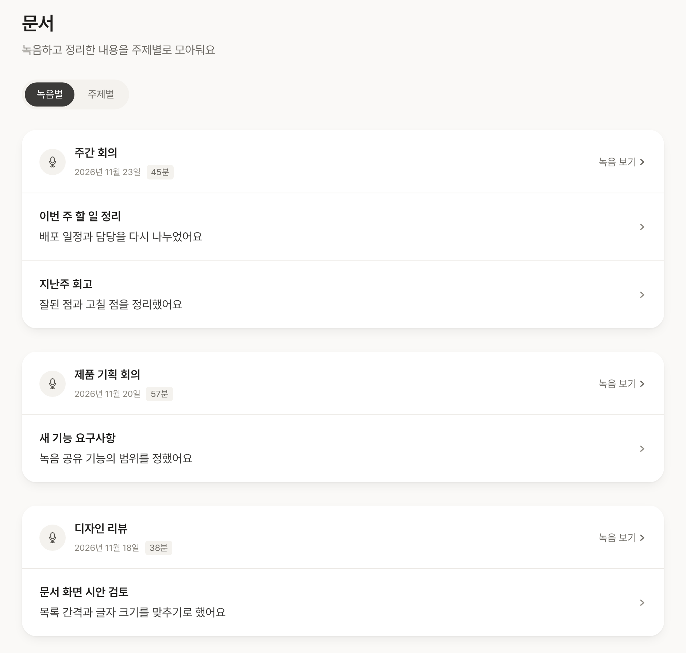
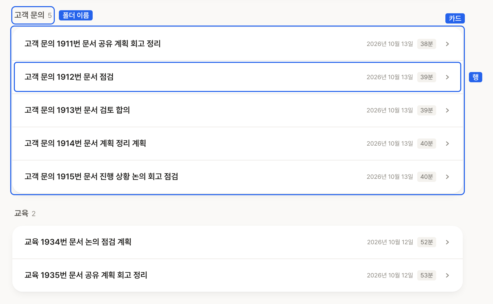

import FolderHtmlPreview from "@/modules/features/demo/FolderHtmlPreview/index.astro";
import FolderListDomDiagram from "@/modules/features/demo/FolderListDomDiagram/index.astro";
import VirtualListDemo from "@/modules/features/demo/VirtualListDemo";
import VirtualizationOptionsDiagram from "@/modules/features/demo/VirtualizationOptionsDiagram/index.astro";
import VirtualizationResultChart from "@/modules/features/demo/VirtualizationResultChart/index.astro";

import knotTopicFolder from "./knot-topic-folder.png";

Knot는 제가 우아한테크코스에서 팀 프로젝트로 만든 서비스입니다. 사용자가 녹음 버튼만 누르면 녹음 전체 전사본과 요약 문서를 자동으로 만들고, 그 문서를 주제별로 쪼개 읽기 쉬운 문서로 관리합니다.

<Figure caption="그림 1. Knot 문서 화면의 「녹음별」 탭입니다. 녹음마다 그 녹음으로 만든 문서들이 함께 묶여 보입니다(시험용 데이터).">



</Figure>

원래 Knot는 사용자가 직접 녹음한 내용만 문서로 정리해 줬는데요, 사용자의 요청에 따라 노션처럼 이미 작성된 문서들을 Knot로 가져와서 관리할 수 있도록 기능 확장을 준비하고 있었습니다. 이를 위해 저희 팀이 작성했던 문서들을 미리 가져왔는데요, 문서 개수가 2,000개 가까이 늘어나자 문서 목록을 보여 주는 화면이 느려지기 시작했습니다.

문서 2,000개를 한 번에 그리다 보니, 화면에 보이지 않는 문서까지 모두 그리고 있었는데요. 개발자 도구로 재 보니(CPU 4배 느리게) 탭을 누르고 목록이 보이기까지 로컬 환경에서 966ms, 운영 환경에서는 1,500ms가 넘게 걸렸습니다.

그래서 화면에 보이는 문서만 그리는 리스트 가상화를 적용했는데요, 같은 조건에서 다시 재 보니 **로컬 환경은 966ms에서 46ms로, 운영 환경은 1,500ms 넘게 걸리던 것이 68ms로 줄어 두 환경 모두 20배 넘게 빨라졌습니다.**

## 리스트 가상화는 무엇일까

리스트 가상화(list virtualization)는 화면에 보이는 행과 위아래 몇 행만 DOM에 그리는 방법입니다. [web.dev의 react-window 안내](https://web.dev/articles/virtualize-long-lists-react-window)도 사용자에게 보이는 부분만 그리는 방식으로 설명합니다. 데이터를 나눠 받는 무한 스크롤과 함께 쓸 수도 있지만, Knot에서는 서버에서 받아 온 1,939개의 데이터를 모두 JavaScript 배열로 들고, DOM에 만드는 행 수를 줄였습니다.

Knot의 문서 목록은 이렇게 생겼습니다. AI가 문서를 주제별로 나눈 폴더마다 폴더 이름이 있고, 그 아래 흰 카드 안에 문서가 한 줄씩 들어가는데요. 이 글에서는 이 세 부분을 그림처럼 「폴더 이름」, 「카드」, 「행」이라고 부르겠습니다.

<Figure caption="그림 2. Knot 문서 화면의 「주제별」 탭입니다. 폴더마다 폴더 이름 아래 카드가 있고, 카드 안에 문서가 행으로 쌓입니다(시험용 데이터).">



</Figure>

화면에 보이는 행만 그리면 끝일 것 같지만, 막상 해 보면 세 가지 문제가 생깁니다. 간단한 예를 하나 들어 볼게요. 행이 2,000개 있고, 행 하나의 높이는 40px, 화면에 보이는 높이는 240px인 리스트입니다.

1. **스크롤바가 짧아집니다.**

   2,000개를 모두 그리면 목록 높이는 2,000 × 40 = 80,000px인데요, 화면에 보이는 것만 그린다면 스크롤할 수 있는 공간이 거의 없어지겠죠? 그래서 실제로는 행을 10개만 그리더라도, 스크롤할 수 있는 높이를 확보하기 위해 80,000px의 공간을 만들어 둡니다. 그러면 스크롤바는 2,000개가 모두 있을 때와 똑같아져요.

2. **그린 행을 어디에 놓을지 정해야 합니다.**

   스크롤을 2,000px 내렸다면 화면 맨 위에는 51번째 행이 와야 합니다. 하지만 DOM에는 앞의 행 50개가 없는 상태입니다! 그래서 DOM에 처음 놓이는 51번째 행이 목록 맨 위에서 50 × 40 = 2,000px 아래에서 시작하도록 위치를 계산해 줍니다. 여기서는 행 하나를 40px로 단순하게 잡았지만, Knot처럼 행마다 높이가 다르면 곱셈으로는 안 되기 때문에 앞 행들의 높이를 차례로 더해 행마다 시작 위치를 미리 계산해 둡니다.

3. **빠르게 스크롤하면 화면이 잠깐 비어 보일 수 있습니다.**

   아래 데모에서 overscan을 0으로 두고 확! 스크롤해 보시겠어요? 화면에 딱 맞게 보이는 행만 그려 두면, 새로 들어오는 행이 아직 그려지지 않아 빈 공간이 잠깐 보일 거예요. 그래서 화면 위아래로 몇 줄을 더 그려 두는데요, 이 여유분을 overscan이라고 부릅니다. overscan은 화면에 보이는 행 위아래로 더 그릴 행의 개수로 정할 수도 있고, 더 그릴 픽셀로 정할 수도 있어요. Knot에서는 휠로 스크롤할 때 빈 공간이 보이는지 재 보고 325px로 정했어요.

<VirtualListDemo client:visible />

## 문서 목록은 왜 느렸을까

처음에는 운영 환경에서 재고 있던 INP[^inp]로 느린 곳을 찾으려고 했는데요, 이상하게도 INP에는 문제가 드러나지 않았습니다. 탭 클릭이 INP로 기록되지 않았어요. 목록을 그리는 무거운 작업은 클릭 처리가 끝난 뒤에 따로 돌고 있었습니다.

그래서 탭을 누른 순간부터 목록이 화면에 보일 때까지를 직접 재 봤습니다. 개발자 도구의 성능 기록에서 메인 스레드가 어디에 시간을 쓰고 있는지 살펴보면 아래와 같습니다.

<Figure caption="표 1. 가상화 전, 탭을 누른 뒤 3초 동안 기록된 주요 작업 시간 (CPU 4배 느리게, 4번 잰 가운데값)" captionSide="top">

| 하는 일 | 걸린 시간 |
|---|---|
| JavaScript 실행 | 676ms |
| Commit[^commit] | 444ms |
| 레이아웃 | 131ms |
| 합계 (스타일 계산, 페인트 같은 그 밖의 일 포함) | 1,383ms |

</Figure>

목록은 966ms쯤에 화면에 보였지만, 그 뒤에도 작업이 이어졌습니다. 클릭 뒤 3초 동안 기록에서 골라 더한 작업 시간은 1,383ms였어요. 작업끼리 겹치는 시간은 빼지 않은 합계라서, 메인 스레드가 실제로 일한 전체 시간과는 구분해야 합니다[^trace-time].

React 쪽도 살펴봤는데요, 탭에 들어가는 순간 React가 새로 만든 컴포넌트가 37,168개였습니다. 문서 행 하나에 컴포넌트가 19개쯤 들어 있었는데, 그게 행 1,939개만큼 곱해진 거예요. 화면에 붙은 HTML 요소도 17,696개였습니다. [Lighthouse의 기존 DOM 크기 검사](https://developer.chrome.com/docs/lighthouse/performance/dom-size)는 노드가 약 800개를 넘으면 경고를 줬는데, 태그만 세어도 그 20배가 넘는 양이었어요[^dom-audit].

결국 특정 컴포넌트 하나가 느린 게 아니라, 보이지도 않는 행까지 한꺼번에 너무 많이 그리는 게 문제처럼 보였습니다.

이 짐작이 맞는지 두 가지를 시험해 봤는데요. 먼저 화면 밖 요소의 렌더링을 미뤄 주는 CSS 속성 `content-visibility`[^cv]를 넣어 봤지만, 716–892ms로 원하는 만큼 줄지 않았습니다. 행은 여전히 DOM에 있고, React도 1,939개를 모두 만들었기 때문이에요. 반대로 응답을 행 30개로 잘라서 그려 보니 44–51ms가 나왔습니다[^methods]. 행과 함께 그리는 요소를 크게 줄이자 시간이 짧아져서, 전체 렌더링 양이 주요 원인이라고 판단했습니다. 그래서 그리는 행 수를 줄이는 리스트 가상화를 적용하기로 했습니다.

## 어떤 방법을 골랐을까

리스트 가상화를 적용하는 방법은 여러 가지가 있어서, Knot 문서 목록의 구조에 어떤 방법이 맞는지 비교해 봤습니다.

<Figure caption="표 2. 리스트 가상화를 적용하는 방법과 따져 본 내용" captionSide="top">

| 방법 | 장점 | 단점 |
| --- | --- | --- |
| TanStack Virtual | 행 높이 측정과 그릴 범위 계산을 맡길 수 있습니다 | 카드마다 가상화 설정을 따로 붙이고, 카드 위치를 재서 scrollMargin 값을 갱신해야 합니다 |
| react-window의 `List` | 쓰기 쉽습니다 | 행 바깥의 요소를 `List`가 만들어서, 카드 안에 행을 바로 넣던 HTML 구조를 고쳐야 합니다 |
| 폴더 이름도 한 칸으로 만들어 한 리스트로 세우기 | 폴더 수가 늘어도 카드마다 그릴 범위를 따로 계산하지 않아도 됩니다 | 카드라는 상자가 없어져서, 흰 바탕과 둥근 모서리를 행마다 따로 그려야 합니다 |
| 직접 구현 (고름) | 원리를 확인할 수 있고 의존성이 늘지 않습니다 | 뒤로 가기와 포커스 문제를 직접 풀어야 합니다 |

</Figure>

<Figure caption="그림 3. 네 방법이 문서 목록에 만드는 모양입니다. TanStack Virtual은 카드마다 설정과 scrollMargin 숫자가 필요하고, react-window의 List는 행 바깥의 요소도 만듭니다. 폴더 이름도 한 칸으로 만든 한 리스트는 카드 모양을 행마다 칠해야 합니다. 직접 구현은 카드 안에서 그리는 행만 그립니다.">
  <VirtualizationOptionsDiagram />
</Figure>

TanStack Virtual과 react-window 같은 라이브러리를 먼저 살펴봤는데요, Knot 문서 목록에는 그대로 쓰기 어려웠습니다. Knot 문서 목록은 페이지 전체가 스크롤되고, 그 안에 폴더마다 카드가 하나씩 있는 구조인데요(그림 2). react-window의 `List`는 행을 감싸는 바깥 요소까지 직접 만듭니다. 카드(`ul`)의 자식으로 행(`li`)을 그리던 HTML 구조를 지키기 어려워서 고르지 않았어요. TanStack Virtual은 카드마다 가상화 설정을 하나씩 만들고, 카드가 스크롤 영역의 시작에서 몇 px 떨어져 있는지를 재서 `scrollMargin`에 넣어 줘야 했습니다. 위쪽 폴더의 높이가 바뀌면 그 값도 다시 갱신해야 하고요.

폴더를 나누는 상자를 아예 없애는 방법도 있었습니다. 폴더 이름도 행처럼 리스트의 한 칸으로 만들어, 모든 칸을 한 리스트로 세우는 거예요. 하지만 그러면 흰 카드라는 상자가 사라지니, 첫 행은 위 모서리를 둥글게, 마지막 행은 아래 모서리를 둥글게, 모든 행에 흰 바탕을 따로 칠해서 카드처럼 보이게 만들어야 했습니다.

그래서 폴더 이름과 카드는 그대로 두고, 카드 안의 행만 라이브러리 없이 직접 가상화하기로 했습니다. 원리를 직접 확인할 수 있고, 의존성도 늘지 않으니까요. 이 결정은 팀의 결정 기록(ADR)[^adr]에 남겨 두었습니다.

## 가상화한 목록은 어떻게 동작할까

그럼 앞에서 본 세 가지 문제를 Knot 문서 목록에서는 어떻게 풀었을까요? 스크롤은 페이지 전체(`main`)가 맡고, 카드마다 자기 행 가운데 몇 번째부터 몇 번째까지를 그릴지 따로 계산해요. 기본으로 그리는 행은 지금 화면에 보이는 행과, 화면 위아래 325px(overscan) 안에 들어온 행입니다. 키보드 포커스가 있는 행은 이 범위 밖에서도 지우지 않는데요, 포커스가 있던 행을 지우면 포커스도 함께 사라져서 키보드로 목록을 보던 사람이 있던 위치를 잃기 때문이에요.

이때 카드가 스크롤 영역의 시작에서 얼마나 떨어져 있는지는 미리 계산해 두지 않아요. 스크롤할 때마다 카드와 스크롤 영역의 현재 위치를 브라우저에게 물어보고(`getBoundingClientRect`), 두 위치의 차이로 그릴 범위를 정합니다. TanStack Virtual에서도 같은 API나 `ResizeObserver`로 카드 위치를 재서 `scrollMargin`을 갱신할 수 있어요[^scroll-margin]. 직접 구현에서는 별도의 `scrollMargin` 값을 관리하지 않고, 그때 잰 위치로 범위를 계산했습니다. 두 방법 모두 전체 목록 높이만큼 스크롤 공간을 확보하지만, 저희는 행 높이를 미리 아는 조건이라 카드 높이를 계산해 고정해 뒀습니다. TanStack Virtual에서 동적으로 행 높이를 재면 전체 높이도 측정 결과에 따라 바뀔 수 있습니다.

1. **스크롤할 수 있는 공간**

   카드의 높이는 행을 모두 그렸을 때의 높이로 미리 계산해서 고정해 둡니다. 그래서 행이 몇 개 그려져 있든 카드 높이는 변하지 않고, 스크롤바 길이와 아래 폴더의 위치도 그대로예요.

2. **행을 놓을 위치**

   그린 행 가운데 첫 번째 행이 시작하는 위치만큼 카드 위쪽에 여백(`padding-top`)을 줍니다.

3. **빠르게 스크롤할 때 비어 보이는 화면**

   화면 위아래 325px(overscan) 안에 들어온 행까지 미리 그려 둡니다. 한 번 움직인 거리가 이 범위 안이면 새로 들어오는 행이 준비돼 있어요. 다만 한 번에 더 멀리 움직이면 화면이 잠깐 비어 보일 수 있습니다.

<Figure caption="그림 4. 실제 화면의 폴더 하나와 문서 목록의 DOM 구조입니다. 폴더 이름은 section 안의 첫 div, 카드는 ul, 행은 li이고, 가상화 뒤에도 폴더 이름과 카드는 모두 그리며 카드 안에서는 그리는 행만 li로 만들고 나머지는 그리지 않은 행의 자리로 비워 둡니다(시험용 데이터).">
  <FolderListDomDiagram image={knotTopicFolder} alt="「고객 문의」 폴더: 폴더 이름과 문서 수 5 아래 카드 하나에 문서 행 다섯 개가 쌓여 있다" />
</Figure>

실제 HTML로 보면 더 잘 보이는데요. 폴더 「프론트엔드」에 문서 4개가 있다고 해 볼게요. 설명하기 쉽게 행 높이는 모두 100px로 두고, 날짜 같은 행 안의 내용은 뺐습니다. 아래 두 예시는 `ul`의 기본 여백을 없애고 `box-sizing: border-box`를 적용한 상태입니다.

<Figure caption="그림 5. 가상화 전 HTML과 그 화면입니다. 폴더 이름 「프론트엔드 4」 아래 카드 400px 안에 행 4개가 100px씩 쌓입니다.">
<FolderHtmlPreview>

```html title="가상화 전: 문서 4개를 모두 그림"
<main>
  <section aria-labelledby="folder-fe">
    <div>
      <h3 id="folder-fe">프론트엔드</h3>
      <span>4</span>
    </div>
    <ul>
      <li><a href="/docs/1">상태 관리 정리</a></li>
      <li><a href="/docs/2">키보드 이동 점검</a></li>
      <li><a href="/docs/3">빌드 시간 줄이기</a></li>
      <li><a href="/docs/4">테스트 이름 규칙</a></li>
    </ul>
  </section>
</main>
```

</FolderHtmlPreview>
</Figure>

이제 화면 높이가 100px이고, 카드 맨 위에서 170px만큼 스크롤했다고 해 보겠습니다. overscan은 20px로 줄였어요. 그러면 화면에 보이는 170–270px에 overscan을 위아래로 더한 150–290px이 그리는 범위이고, 여기에 걸치는 행은 2번째와 3번째 행입니다.

<Figure caption="그림 6. 가상화 후 HTML과 그 화면입니다. 카드 400px 가운데 화면(170–270px)과 overscan 20px에 걸친 2번째와 3번째 행만 그리고, 위아래 100px는 그리지 않은 행의 자리로 둡니다.">
<FolderHtmlPreview isVirtualized>

```html title="가상화 후: 화면 위쪽 끝이 카드 맨 위에서 170px 아래"
<main>
  <section aria-labelledby="folder-fe">
    <div>
      <h3 id="folder-fe">프론트엔드</h3>
      <span>4</span>
    </div>
    <!-- 높이: 4행 400px, 위쪽 여백: 그리는 첫 행 시작 100px -->
    <ul style="height: 400px; padding-top: 100px">
      <li aria-posinset="2" aria-setsize="4">
        <a href="/docs/2">키보드 이동 점검</a>
      </li>
      <li aria-posinset="3" aria-setsize="4">
        <a href="/docs/3">빌드 시간 줄이기</a>
      </li>
    </ul>
  </section>
</main>
```

</FolderHtmlPreview>
</Figure>

달라진 건 카드(`ul`)에 붙은 두 값뿐입니다. `height: 400px`은 행 4개를 모두 그렸을 때의 높이라서 스크롤할 수 있는 공간을 지켜 주고, `padding-top: 100px`은 1번째 행이 있어야 할 자리를 비워 둬서 2번째 행이 원래 위치(100px)에 놓이게 해 줍니다. JavaScript는 여전히 문서 4개를 모두 들고 있고, 「상태 관리 정리」와 「테스트 이름 규칙」을 DOM으로 만들지 않았을 뿐이에요.

스크롤하거나 목록 영역의 크기가 바뀌면 이 범위를 다시 계산하는데, 범위가 그대로면 다시 그리지 않습니다. 코드에 있는 `aria-posinset`과 `aria-setsize`는 일부만 그린 리스트에서도 그 행이 몇 번째인지, 행이 모두 몇 개인지 화면 낭독기에 알려 주는 값이에요.

## 얼마나 달라졌을까

가상화를 적용하고 같은 조건(CPU 4배 느리게)에서 다시 재 보니, 「주제별」 탭을 누르고 목록이 보이기까지 걸리는 시간이 966ms에서 46ms로 95% 줄었습니다[^builds].

<Figure caption="그림 7. 개선 전과 후 (시험용 데이터 문서 1,939개, CPU 4배 느리게). 시간은 가운데값이고 막대 길이는 항목마다 개선 전 값에 맞췄습니다. 컴포넌트 수는 탭에 들어간 뒤의 커밋들에서 마운트한 수를 더한 값입니다. 값은 Knot PR #1142에서 가져왔습니다.">
  <VirtualizationResultChart />
</Figure>

앞에서 본 작업 시간도 크게 줄었는데요. 탭을 누른 뒤 3초 동안 기록에서 같은 종류의 작업 시간을 더해 보니 1,383ms에서 250ms가 됐습니다.

<Figure caption="표 3. 탭을 누른 뒤 3초 동안 기록된 주요 작업 시간 (CPU 4배 느리게, 4번 잰 가운데값)" captionSide="top">

| 하는 일 | 가상화 전 | 가상화 후 |
| --- | ---: | ---: |
| JavaScript 실행 | 676ms | 164ms |
| Commit | 444ms | 44ms |
| 레이아웃 | 131ms | 4ms |
| 합계 (스타일 계산, 페인트 같은 그 밖의 일 포함) | 1,383ms | 250ms |

</Figure>

DOM도 가벼워졌습니다. DOM에 있던 문서 행은 1,939개에서 13개로, 페이지의 HTML 요소는 17,696개에서 354개로 줄었어요. 탭에 들어갈 때 React가 새로 만든 컴포넌트도 37,168개에서 558개로 줄었습니다. 그런데도 스크롤할 수 있는 높이는 두 빌드 모두 128,317px로 똑같았는데요, 카드 높이를 미리 계산해 고정해 둔 덕분이에요.

### 메모리도 줄었을까

이 글을 정리하면서 메모리도 다시 재 봤습니다. 같은 두 빌드에 같은 데이터를 넣고 재 보니, JavaScript가 쓰는 메모리(JS heap)[^heap]는 50.6MiB에서 10.0MiB로, DOM 노드[^node]는 23,607개에서 479개로 줄었습니다.

<Figure caption="표 4. 다시 잰 메모리와 DOM 수 (CPU 제한 없음, 두 빌드를 번갈아 5번씩 잰 가운데값)" captionSide="top">

| 지표 | 가상화 전 | 가상화 후 |
| --- | ---: | ---: |
| JS heap 사용량 | 50.6MiB | 10.0MiB |
| DOM 노드 | 23,607개 | 479개 |
| HTML 요소 | 17,696개 | 354개 |
| DOM에 있는 문서 행 | 1,939개 | 13개 |

</Figure>

문서 데이터 1,939개는 두 빌드 모두 메모리에 그대로 있습니다. 그리는 행을 줄이자 JS heap도 40MiB가량 줄었는데요, 힙 스냅숏은 찍지 않아서 어떤 객체가 얼마나 줄었는지는 확인하지 못했습니다.

### 다른 조건에서도 줄었을까

조건을 바꿔 재 봐도 결과는 같은 방향이었습니다. 세션 녹화 도구를 켜도, CPU를 느리게 하지 않아도, 날을 바꿔 다시 재도, 배포 뒤 운영 환경에서 재도 모두 크게 줄었어요.

<Figure caption="표 5. 조건별 「주제별」 클릭부터 목록이 보일 때까지 (로컬은 가운데값, 괄호 안은 잰 횟수)" captionSide="top">

| 조건 | 개선 전 | 개선 후 |
| --- | ---: | ---: |
| 로컬, CPU 4배 느림, 세션 녹화 켬 (9번) | 1,729ms | 67ms |
| 로컬, CPU 제한 없음 (12번) | 222ms | 21ms |
| 로컬, CPU 4배 느림, 다른 날 다시 잼 (12번) | 896ms | 45ms |
| 운영, CPU 4배 느림, 세션 녹화 켬 | 1,530–1,631ms (범위만) | 59–71ms (배포 뒤 5번, 가운데값 68ms) |

</Figure>

## 가상화로 잃은 것은 무엇일까

빨라진 대신 포기한 것도 있습니다.

- 브라우저 찾기(Cmd+F)는 DOM에 있는 글자만 찾기 때문에, 그리지 않은 행의 문서 제목은 찾을 수 없어요.
- 행 높이를 그리기 전에 미리 계산하므로, 행의 여백이나 글자 크기를 바꾸는 디자인 변경이 생기면 높이 계산도 함께 고쳐야 합니다.
- 카드마다 그릴 범위를 따로 계산하니, 폴더가 28개면 스크롤할 때마다 계산도 28번 합니다. 폴더가 아주 많아져 이 계산이 느려지면 「폴더 이름도 한 칸으로 만들어 한 리스트로 세우기」를 다시 검토하기로 ADR에 적어 두었습니다.

## 정리

- 리스트 가상화는 화면에 보이는 행과 overscan 안의 행을 DOM에 그리는 방법입니다. Knot에서는 문서 데이터를 모두 받아 둔 채 그리는 행 수를 줄였고, 포커스가 있는 행은 범위 밖에서도 지우지 않았습니다.
- Knot 문서 목록은 보이지 않는 행까지 1,939개를 한꺼번에 그려서 느렸습니다. 응답을 행 30개로 줄이는 실험에서 44–51ms가 나와, 렌더링 양이 주요 원인이라고 판단했습니다.
- 폴더 이름과 카드는 그대로 두고 카드 안의 행만 직접 가상화했습니다. 카드 높이를 미리 고정해 스크롤할 수 있는 공간을 지키고, 위쪽 여백으로 그린 행을 원래 위치에 놓았습니다.
- 탭을 누르고 목록이 보이기까지 966ms에서 46ms로, JS heap은 50.6MiB에서 10.0MiB로 줄었습니다.
- 대신 그리지 않은 행은 브라우저 찾기로 찾을 수 없고, 행 높이를 바꾸면 높이 계산도 함께 고쳐야 합니다.

<details>
<summary>측정 조건 자세히 보기</summary>

<Figure caption="표 6. 측정 조건" captionSide="top">

| 항목 | 조건 |
| --- | --- |
| 데이터 | 측정 기록에 있는 문서 1,939개, 폴더 28개, 폴더별 문서 수(가장 큰 폴더 994개), 요약 행의 위치를 따라 시험용 응답을 만들었습니다. 제목과 폴더 이름, 날짜, ID, 녹음 길이 등은 지어낸 값입니다. |
| 장비 | M5 Pro Mac에서 시간은 Playwright의 Chrome으로, 메모리는 ego-browser의 Chromium으로 쟀습니다. 둘 다 창은 1200×818, 화면 배율은 2입니다. 빠른 장비라 CPU를 4배 느리게 해도 저가 노트북이나 휴대폰보다는 빠를 수 있습니다. |
| 횟수 | 가상화 전과 후 빌드를 번갈아 12번씩 재서 가운데값을 썼습니다. 12번의 범위는 가상화 전 892–1,155ms, 가상화 후 45–55ms였고, 로컬 서버는 응답마다 100ms 늦게 줬습니다. |
| 끝 시점 | 행이 생긴 뒤 다음 `requestAnimationFrame`에서 보낸 신호가 도착한 때까지 쟀습니다. 실제 화면에 그려진 시각을 어림한 값입니다. |
| 세션 녹화 도구 | 운영 환경에는 사용자의 화면 동작을 기록하는 분석 도구가 켜져 있습니다. 이 도구를 켠 로컬 빌드에서는 가상화 전 값이 1,729ms로 더 길었습니다. |
| 컴포넌트 수 | Profiler용 빌드에서 탭을 누른 뒤 React가 마운트한 컴포넌트를 셌습니다. `div` 같은 HTML 요소는 세지 않습니다. |
| 메모리 | 11월 23일에 따로 잰 값입니다. 줄어든 메모리가 무엇으로 이루어졌는지는 힙 스냅숏을 찍지 않아 나누지 못했습니다. |
| 재지 않은 것 | 문서가 적은 워크스페이스와 실제 휴대폰에서는 재지 않았습니다. |

</Figure>

</details>

[^inp]: INP(Interaction to Next Paint)는 클릭이나 키 입력부터 그 입력 뒤에 화면이 다시 그려질 때까지의 시간을 보는 지표입니다. [web.dev의 INP 설명](https://web.dev/articles/inp)

[^commit]: Commit은 메인 스레드가 레이어 트리와 페인트 순서 정보를 합성기 스레드로 넘기는 단계입니다. [Chrome의 렌더링 단계 설명](https://developer.chrome.com/blog/inside-browser-part3)

[^trace-time]: 표 1과 표 3은 성능 기록에서 JavaScript 실행, 스타일 계산, 레이아웃, 페인트 준비, 페인트, 레이어 구성, Commit, 가비지 컬렉션 항목의 시간을 더한 값입니다. 중첩된 기록의 시간은 빼지 않았으므로, 합계가 실제 메인 스레드의 활동 시간과 같다고 볼 수는 없습니다.

[^dom-audit]: 약 800개 기준은 기존 검사에 해당합니다. Lighthouse 13부터는 [Optimize DOM size](https://developer.chrome.com/docs/performance/insights/dom-size)로 바뀌었으며, 노드 수뿐 아니라 스타일 계산과 레이아웃에 오래 걸리는지도 함께 봅니다.

[^cv]: `content-visibility: auto`는 화면 밖 요소의 레이아웃과 페인트 같은 렌더링 작업을 미루는 CSS 속성입니다. 요소는 DOM에 그대로 남습니다. [MDN의 content-visibility 설명](https://developer.mozilla.org/en-US/docs/Web/CSS/content-visibility)

[^adr]: 결정 기록(Architecture Decision Record)은 무엇을 왜 골랐는지 남겨 두는 문서입니다. 이 결정은 [Knot 저장소의 ADR 1117](https://github.com/woowacourse-teams/2026-Knot/blob/9ad265327b266505230f8655319a86732c744ecb/backend/docs/adr/1117-topic-document-list-virtualization.md)에 있습니다.

[^methods]: `content-visibility`와 행 30개 실험의 수치는 ADR 1117에 기록된 결과입니다. 원시 측정 파일은 현재 보관된 자료에 없어 범위를 다시 계산하지 못했습니다.

[^scroll-margin]: [TanStack Virtual의 scrollMargin 설명](https://tanstack.com/virtual/latest/docs/api/virtualizer#scrollmargin)은 `getBoundingClientRect`나 `ResizeObserver`로 값을 동적으로 재서 갱신하는 방법을 안내합니다. `getTotalSize`로 얻는 전체 크기도 행을 재는 결과에 따라 바뀔 수 있습니다.

[^builds]: 당시 빌드 기록에 따르면 가상화 전은 develop 브랜치 `11ac67db`, 가상화 후는 PR #1142의 커밋 `90218587`까지 넣은 빌드입니다. 이 두 보존 빌드로 2026년 11월 12일에 쟀으며, 빌드와 커밋의 대응은 당시 기록을 따랐습니다. Knot 프론트엔드는 React 19.2를 씁니다.

[^heap]: JS heap 사용량은 페이지의 JavaScript 객체가 쓰는 메모리로, 브라우저 전체가 쓰는 메모리와는 다릅니다. Chrome DevTools Protocol의 `Performance.getMetrics`가 주는 `JSHeapUsedSize`를 가비지 컬렉션을 두 번 돌린 뒤 읽었습니다.

[^node]: DOM 노드는 글자 노드까지 센 값이라 태그만 센 HTML 요소 수보다 많습니다. 예를 들어 `<li><a>상태 관리 정리</a></li>`는 요소 2개, 노드 3개입니다.
